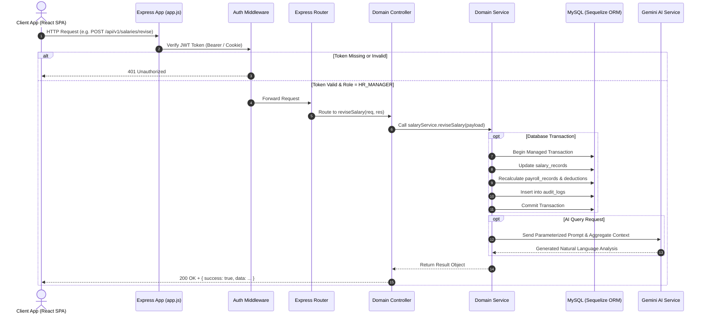
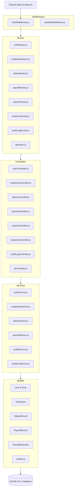

# PayDesk HRMS — Backend Architecture & Layered Design

## 1. Architectural Pattern: Controller-Service-Repository (CSR)
The PayDesk backend strictly enforces the **Layered Controller-Service-Repository Pattern**:
- **Routes Layer**: Maps HTTP endpoints, applies validation and authentication middlewares.
- **Controllers Layer**: Extracts request payloads, parses query parameters, invokes domain services, and formats standard JSON responses.
- **Services Layer**: Encapsulates 100% of business logic, financial formulas, ACID transactions, and external AI integrations.
- **Models / Data Layer**: Sequelize models defining MySQL tables, column types, relationships, and lifecycle hooks.

---

## 2. Directory Structure

```text
src/
├── app.js                   # Express application setup, middleware configuration
├── server.js                # Server entrypoint listening on process.env.PORT
├── config/
│   ├── database.js          # Sequelize connection settings and dialect options
│   └── dbConnection.js      # Database connectivity health checker
├── constants/               # Global enumerations (roles, statuses)
├── controllers/             # HTTP request handlers
│   ├── aiController.js
│   ├── analyticsController.js
│   ├── auditLogController.js
│   ├── authController.js
│   ├── employeeController.js
│   ├── exportController.js
│   ├── payrollController.js
│   └── salaryController.js
├── middlewares/             # Interceptors
│   ├── authMiddleware.js    # Dual-token JWT verification and role checking
│   └── validateMiddleware.js# Joi / validation handlers
├── models/                  # Sequelize ORM schema definitions
│   ├── AuditLog.js
│   ├── Employee.js
│   ├── PayrollDeduction.js
│   ├── PayrollRecord.js
│   ├── Role.js
│   ├── SalaryRecord.js
│   ├── User.js
│   └── index.js             # Model associations and relationship definitions
├── routes/                  # Express route routers
│   ├── aiRoutes.js
│   ├── analyticsRoutes.js
│   ├── auditLogRoutes.js
│   ├── authRoutes.js
│   ├── employeeRoutes.js
│   ├── exportRoutes.js
│   ├── payrollRoutes.js
│   └── salaryRoutes.js
├── services/                # Pure business logic and domain services
│   ├── analyticsService.js
│   ├── auditService.js
│   ├── authService.js
│   ├── employeeService.js
│   ├── payrollService.js
│   └── salaryService.js
├── utils/                   # Shared utility helpers
│   ├── cookie.js            # Cookie options generator
│   └── token.js             # JWT generation and verification
└── validators/              # Input schema validation rules
```

---

## 3. Request Lifecycle Sequence Diagram



---

## 4. Backend Component Relationship Map



---

## 5. Transaction & Consistency Boundaries
All state-modifying operations that touch more than one table must execute inside a Sequelize managed transaction:

```javascript
const transaction = await sequelize.transaction();
try {
  // 1. Delete dependent deductions
  // 2. Delete payroll records
  // 3. Delete salary records
  // 4. Delete audit logs
  // 5. Delete employee row
  await transaction.commit();
} catch (error) {
  await transaction.rollback();
  throw error;
}
```

This prevents database corruption, orphaned records, and foreign key constraint crashes during employee deletion or compensation restructuring.

---

## 6. Engineering & Documentation Artifacts

- [ai-prompts.md](ai-prompts.md) — Prompts or instructions used with AI tools
- [requirements.md](requirements.md) — Functional specifications, statutory calculation rules, and 10k employee scope
- [database-design.md](database-design.md) — 7-table schema, foreign key relations, and indexing strategy
- [testing.md](testing.md) — 14-suite test architecture covering controllers, services, middlewares, and models
