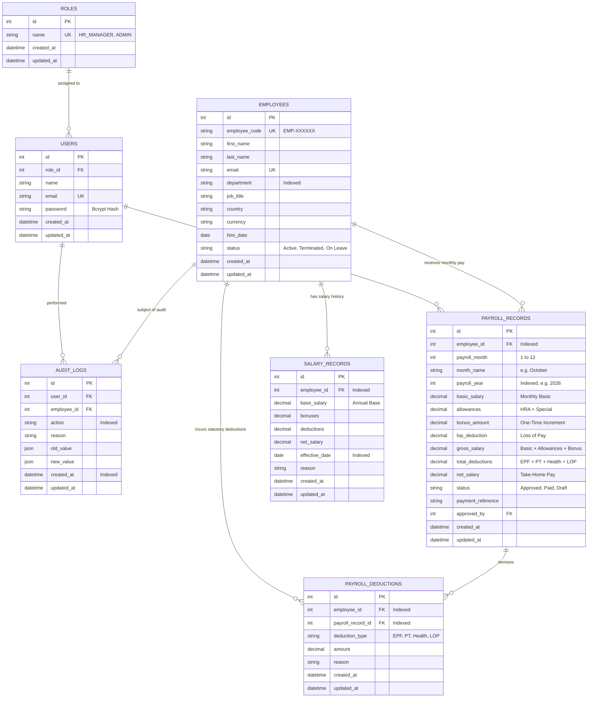

# PayDesk HRMS — Database Schema & Data Dictionary

## 1. Database Overview
- **Database Engine**: MySQL 8.0+ (InnoDB Storage Engine)
- **ORM**: Sequelize 6.x
- **Character Set**: `utf8mb4` with `utf8mb4_unicode_ci` collation
- **Key Tenet**: Strict foreign key constraints with indexed lookup columns for high performance across 10,000+ records.

---

## 2. Table Specifications

### 2.1 Table: `roles`
Stores role-based access levels.
| Column | Type | Constraints | Description |
| :--- | :--- | :--- | :--- |
| `id` | INT | Primary Key, Auto Increment | Unique role identifier |
| `name` | VARCHAR(50) | NOT NULL, UNIQUE | Role name (`HR_MANAGER`, `ADMIN`) |
| `created_at` | DATETIME | NOT NULL | Record creation timestamp |
| `updated_at` | DATETIME | NOT NULL | Record update timestamp |

### 2.2 Table: `users`
Stores authenticated HR staff credentials.
| Column | Type | Constraints | Description |
| :--- | :--- | :--- | :--- |
| `id` | INT | Primary Key, Auto Increment | Unique user identifier |
| `role_id` | INT | Foreign Key -> `roles(id)` | User access role |
| `name` | VARCHAR(100) | NOT NULL | User full name |
| `email` | VARCHAR(100) | NOT NULL, UNIQUE | Corporate email address |
| `password` | VARCHAR(255) | NOT NULL | Bcrypt hashed password |
| `created_at` | DATETIME | NOT NULL | Record creation timestamp |
| `updated_at` | DATETIME | NOT NULL | Record update timestamp |

### 2.3 Table: `employees`
Core table for all 10,000 organizational personnel.
| Column | Type | Constraints | Description |
| :--- | :--- | :--- | :--- |
| `id` | INT | Primary Key, Auto Increment | Unique employee ID |
| `employee_code` | VARCHAR(20) | NOT NULL, UNIQUE, INDEX | Code (e.g. `EMP-001248`) |
| `first_name` | VARCHAR(50) | NOT NULL | Employee first name |
| `last_name` | VARCHAR(50) | NOT NULL | Employee last name |
| `email` | VARCHAR(100) | NOT NULL, UNIQUE | Corporate email address |
| `department` | VARCHAR(50) | NOT NULL, INDEX | Department (Engineering, Sales, etc.) |
| `job_title` | VARCHAR(100) | NOT NULL | Job designation |
| `country` | VARCHAR(50) | NOT NULL | Country of employment |
| `currency` | VARCHAR(10) | NOT NULL | Base currency code (`INR`, `USD`, etc.) |
| `hire_date` | DATE | NOT NULL | Date of joining |
| `status` | ENUM | NOT NULL, DEFAULT 'Active' | `Active`, `Terminated`, `On Leave` |
| `created_at` | DATETIME | NOT NULL | Record creation timestamp |
| `updated_at` | DATETIME | NOT NULL | Record update timestamp |

### 2.4 Table: `salary_records`
Chronological salary structures and historical revisions.
| Column | Type | Constraints | Description |
| :--- | :--- | :--- | :--- |
| `id` | INT | Primary Key, Auto Increment | Unique record ID |
| `employee_id` | INT | Foreign Key -> `employees(id)`, INDEX | Associated employee |
| `base_salary` | DECIMAL(12, 2)| NOT NULL | Annual base salary |
| `bonuses` | DECIMAL(12, 2)| DEFAULT 0.00 | Performance incentive amount |
| `deductions` | DECIMAL(12, 2)| DEFAULT 0.00 | Total statutory deductions |
| `net_salary` | DECIMAL(12, 2)| NOT NULL | Net annual take-home figure |
| `effective_date`| DATE | NOT NULL, INDEX | Effective start date |
| `reason` | VARCHAR(255) | NULL | Justification for revision |
| `created_at` | DATETIME | NOT NULL | Record creation timestamp |
| `updated_at` | DATETIME | NOT NULL | Record update timestamp |

### 2.5 Table: `payroll_records`
Monthly processed payroll cycles and pay runs.
| Column | Type | Constraints | Description |
| :--- | :--- | :--- | :--- |
| `id` | INT | Primary Key, Auto Increment | Unique pay run ID |
| `employee_id` | INT | Foreign Key -> `employees(id)`, INDEX | Target employee |
| `payroll_month`| INT | NOT NULL (1–12) | Numeric month |
| `month_name` | VARCHAR(20) | NOT NULL | Name (e.g. `October`) |
| `payroll_year` | INT | NOT NULL, INDEX | Calendar year (e.g. `2026`) |
| `basic_salary` | DECIMAL(12, 2)| NOT NULL | Monthly basic pay |
| `allowances` | DECIMAL(12, 2)| DEFAULT 0.00 | HRA + Special allowances |
| `bonus_amount` | DECIMAL(12, 2)| DEFAULT 0.00 | One-time monthly increment / bonus |
| `lop_deduction`| DECIMAL(12, 2)| DEFAULT 0.00 | Loss of pay deduction |
| `gross_salary` | DECIMAL(12, 2)| NOT NULL | Gross earnings |
| `total_deductions`| DECIMAL(12, 2)| NOT NULL | Total statutory deductions |
| `net_salary` | DECIMAL(12, 2)| NOT NULL | Final net take-home salary |
| `status` | ENUM | NOT NULL, DEFAULT 'Approved'| `Draft`, `Under Review`, `Approved`, `Paid` |
| `payment_reference`| VARCHAR(100)| NULL | Disbursed reference code |
| `approved_by` | INT | Foreign Key -> `users(id)` | Approving HR Manager |
| `created_at` | DATETIME | NOT NULL | Record creation timestamp |
| `updated_at` | DATETIME | NOT NULL | Record update timestamp |

### 2.6 Table: `payroll_deductions`
Itemized statutory deductions linked to specific pay runs and employees.
| Column | Type | Constraints | Description |
| :--- | :--- | :--- | :--- |
| `id` | INT | Primary Key, Auto Increment | Unique deduction ID |
| `employee_id` | INT | Foreign Key -> `employees(id)`, INDEX | Associated employee |
| `payroll_record_id`| INT | Foreign Key -> `payroll_records(id)`, INDEX | Associated payroll cycle |
| `deduction_type` | VARCHAR(50)| NOT NULL | `EPF`, `Professional Tax`, `Health Insurance`, `Loss of Pay` |
| `amount` | DECIMAL(12, 2)| NOT NULL | Deducted amount |
| `reason` | VARCHAR(255)| NULL | Regulatory or audit justification |
| `created_at` | DATETIME | NOT NULL | Record creation timestamp |
| `updated_at` | DATETIME | NOT NULL | Record update timestamp |

### 2.7 Table: `audit_logs`
Immutable compliance audit trail for compensation revisions and administrative actions.
| Column | Type | Constraints | Description |
| :--- | :--- | :--- | :--- |
| `id` | INT | Primary Key, Auto Increment | Unique audit entry ID |
| `user_id` | INT | Foreign Key -> `users(id)`, NULL | Acting HR user |
| `employee_id` | INT | Foreign Key -> `employees(id)`, NULL | Impacted employee |
| `action` | VARCHAR(100)| NOT NULL, INDEX | `SALARY_REVISED`, `EMPLOYEE_DELETED`, etc. |
| `reason` | VARCHAR(255)| NULL | Action rationale |
| `old_value` | JSON | NULL | Previous state payload |
| `new_value` | JSON | NULL | New state payload |
| `created_at` | DATETIME | NOT NULL, INDEX | Audit timestamp |
| `updated_at` | DATETIME | NOT NULL | Record update timestamp |

---

## 3. Entity-Relationship (ER) Diagram

---

## 4. Relationship Cardinalities & Integrity Rules

- **One Role to Many Users (`1 : N`)**: Multiple HR administrators can hold the `HR_MANAGER` or `ADMIN` role.
- **One Employee to Many Salary Records (`1 : N`)**: Tracks historical pay raises and base salary revisions over time.
- **One Employee to Many Payroll Records (`1 : N`)**: Each employee receives a distinct pay record for each calendar month worked.
- **One Payroll Record to Many Payroll Deductions (`1 : N`)**: Each monthly cycle contains itemized breakdown rows for EPF, Professional Tax, Health Insurance, and Loss of Pay.
- **One Employee to Many Audit Logs (`1 : N`)**: Every salary revision, increment, or onboarding generates an immutable audit record.
- **Cascading Deletion Protocol**: Managed in strict topological order (`payroll_deductions` -> `payroll_records` -> `salary_records` -> `audit_logs` -> `employees`) inside a Sequelize transaction to guarantee zero orphaned rows.
