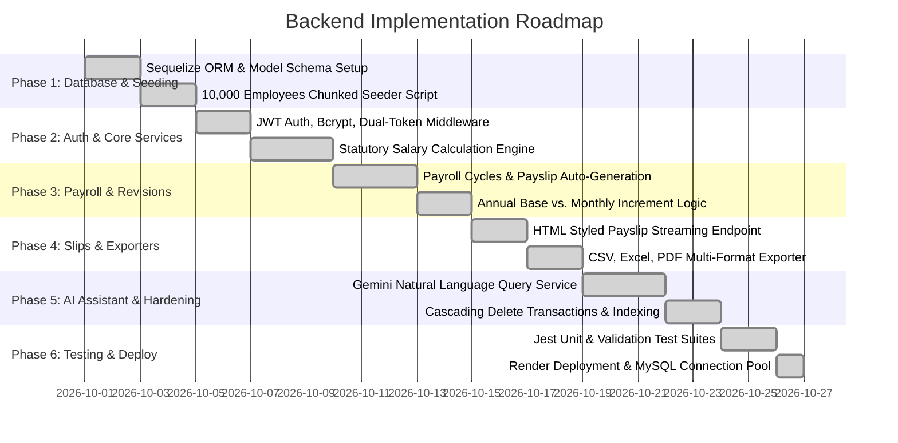

# PayDesk HRMS — Backend Project Planning & Implementation Roadmap

## 1. Planning Methodology
The backend was developed using a layered, domain-driven approach ensuring high maintainability, strict separation of concerns, and full ACID transaction guarantees.

---

## 2. Implementation Phases & Milestones

---

## 3. Phase Breakdown Details

### Phase 1: Database Architecture & High-Scale Seeding
- Created relational schemas: `employees`, `salary_records`, `payroll_records`, `payroll_deductions`, `roles`, `users`, and `audit_logs`.
- Built `seedEmployees.js` using chunked transactions (500 records per batch) to seed 10,000 realistic employees across 9 countries in under 15 seconds.

### Phase 2: Authentication & Statutory Compensation
- Configured Express server with CORS, cookie-parser, and json body-parser.
- Implemented `authMiddleware.js` accepting JWT via Bearer header or HTTP-only cookie.
- Built `salaryService.js` implementing statutory Indian payroll formulas (Basic, HRA, Special Allowance, EPF, PT, Health, and LOP).

### Phase 3: Payroll Records & Revisions
- Built `payrollService.js` to manage monthly payroll cycles.
- Added support for auto-generating missing active cycles for seamless slip downloads.
- Implemented dual-mode revisions: permanent annual base vs. one-time monthly bonuses.

### Phase 4: Document Generation & Export Engine
- Built `exportController.js` supporting streaming CSV, tab-delimited Excel (.xls), and printable HTML reports.
- Engineered official HTML salary slip template with itemized earnings, deductions, and payment references.

### Phase 5: AI Compensation Assistant & Transactions
- Implemented `aiService.js` and `aiController.js` connecting to Google Gemini with live schema introspection.
- Wrapped all multi-table mutations (revisions, employee deletion) in Sequelize database transactions.

### Phase 6: Automated Testing & Deployment
- Automated Jest test suites covering statutory formulas, token helpers, and input validations.
- Configured connection pooling and deployed backend to Render.
